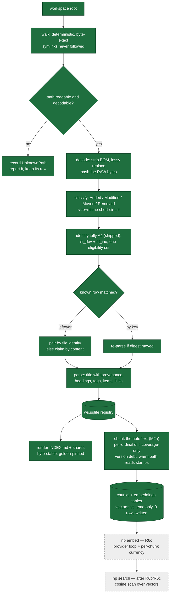

# Plan: what is built, what is next, and the steps in between

Date: 2026-10-28 · **refreshed 2026-10-29 at `main` = `6b46a12`, branch `m13/local-embeddings` = `f526751`**
Companion to `docs/roadmap-2026-10-27.md` (milestones, protocol, gate list) and `todo.md` (handoff).
This document answers a different question: **what does the machine do today, and in what order does the rest arrive?**
For the full feature-gap table — everything the spec promises that no code implements yet — read
`docs/roadmap-2026-10-27.md` §3B; this page is the shape of it, not the inventory.

Legend used by every diagram below:

| style | meaning |
|---|---|
| solid, filled | shipped on `main`, tested, released |
| dashed | exists on branch `m13/local-embeddings`, not merged |
| grey | planned, no code yet |

**The one-sentence state:** indexing is finished and hardened to the point where a scan of 2k notes is ~63 ms warm and its output
bytes have not moved since M1; **nothing that finds, reviews, or talks about your notes exists yet**, because the program can store
vectors but cannot produce one.

---

## 1. The scan pipeline as it runs today

**Nothing above reads vectors, and nothing writes one.** That fence is deliberate: it is why the golden bytes have not moved since M1,
and it is the reason `np search` cannot be built before the runtime exists. The chunker runs on every scan today, so when R6b lands there
is text to embed already in the table — the first embedding pass costs no re-scan.

---

## 2. Milestones: shipped, in flight, planned

```mermaid
flowchart LR
    subgraph DONE["Shipped — main, verified by local exit codes. Windows jobs executed through 2026-10-29T13:11 UTC and were green at 9193732; zero steps 2026-10-29T14:39→2026-10-31T20:23; running again since 2026-11-01T20:08 — red on Windows on all 43 runs from a816b17 until F34 landed; green again at b2840f9"]
        M1["M1 core catalog<br/>np scan + INDEX.md"]
        H1["Hardening line<br/>F13 F18 F19 F20 F21 F22 F23"]
        H2["Correctness residue<br/>F24 F17 F16 A4"]
        REL["Releases v0.1.0<br/>Windows Linux macOS"]
        M2A["M2a storage + models<br/>chunks, embeddings schema,<br/>np models install/hash/list"]
    end

    subgraph BRANCH["In flight — branch m13/local-embeddings"]
        R6A["R6a local-model seam<br/>provider built from an installed row,<br/>nine typed refusals, max_tokens"]
    end

    subgraph NEXT["Planned — each needs a design reviewed first"]
        R6B["R6b inference<br/>llama.cpp binding, pool+norm at 768,<br/>budget over real tokens"]
        R6C["R6c np embed<br/>write vectors,<br/>report chunks owed"]
        SRCH["np search / np related<br/>cosine scan; FTS5 shape is an open question"]
        R7["R7a marker · R7b np models fetch<br/>· R7c multimodal spike"]
        M2B["M2b clustering + review queue<br/>clusters, membership,<br/>approve → write a wikilink"]
        M2C["M2c grounded compression<br/>into processed/"]
        M3["M3 daily files +<br/>item timelines"]
        M4["M4 daemon npd, watcher,<br/>loopback API, autostart"]
        M5["M5 web UI"]
        M6["M6 desktop shell<br/>Tauri client + installers"]
        CHAT["Chat panel with file:line citations<br/>(phase 2; first HTTP client in the tree)"]
    end

    R6A --> R6B --> R6C --> SRCH
    R6B --> R7
    SRCH --> M2B --> M2C --> M3 --> M4 --> M5 --> M6
    SRCH --> CHAT
    M1 -.-> R6A
    M2A -.-> R6A
    REL -.-> M4

    classDef done fill:#1f6f3f,color:#fff,stroke:#0d3d22
    classDef wip fill:#b8860b,color:#fff,stroke:#7a5a08,stroke-dasharray: 4 3
    classDef todo fill:#eee,stroke:#999,color:#333
    class M1,H1,H2,REL,M2A done
    class R6A wip
    class R6B,R6C,SRCH,R7,M2B,M2C,M3,M4,M5,M6,CHAT todo
```

**Why search sits before clustering.** A cluster nobody can query is a report. Once `np search` returns ranked notes with evidence, the
review queue has something to attach to, and the contradiction view becomes a rendering problem rather than a research project.

---

## 3. What is left inside the embeddings milestone, in order

Each box is one bounded round: fresh implementer, fresh scoped reviewer, fix loop for Critical/Important, whole-branch review at the end,
merge only on your word. Full reasoning: `docs/design-m2-local-embeddings.md` §9's round table.

```mermaid
flowchart TD
    A["R6a DONE — seam<br/>local-model feature, LocalModelProvider<br/>from an installed models row, RuntimeNotBuilt"]
    B["R6b0 — dependency + link<br/>vendored-revision grep for gemma-embedding2,<br/>the four-step CI job §2 promises but never ran,<br/>pin table as data, reserved fetch file names"]
    C["R6b1/R6b2 — load → tokenize → forward<br/>mean-pool → L2-norm at native 768,<br/>budget over real token counts,<br/>self-consistency vs an independent reference"]
    D["R6c — np embed<br/>provider loop, embeddings.source_hash currency,<br/>four labelled exit arms, scan report counts chunks owed"]
    E["R6d — benchmark (three rounds done)<br/>mmap-first load pulls the whole 309,855,456-byte artifact;<br/>OpenMP A/B measured; corpus run: 16,161 chunks/hour,<br/>+1,436 KiB drift over 2,048 decodes (no leak at that scale);<br/>batching's ceiling measured at ~14 % of a short decode;<br/>D13's thread sweep measured: 2.90× short / 3.60× long at 16 workers,<br/>vectors bit-identical, +6.6 MiB — the default is now an open decision"]
    F["R7a — marker only<br/>.fetching.&lt;id&gt;.json / .part.&lt;id&gt;.&lt;nonce&gt;,<br/>'fetching' listing section, offline-testable"]
    G["R7b — np models fetch<br/>GET → .part → streaming digest → pin compare → rename,<br/>two files two digests, four named refusals, no resume"]
    H["R7c — multimodal spike (conditional)<br/>pooled 768-d over mixed text+image tokens,<br/>or image search leaves the roadmap"]

    A --> B --> C --> D --> E --> F --> G --> H

    classDef done fill:#1f6f3f,color:#fff,stroke:#0d3d22
    classDef next fill:#b8860b,color:#fff,stroke:#7a5a08
    classDef todo fill:#eee,stroke:#999,color:#333
    class A done
    class B next
    class C,D,E,F,G,H todo
```

**Why the fetch work sits *after* inference.** The marker is the human-visible half of "is it downloading?" and is testable offline by
planting files, so R7a does not wait on any network code; the network round stays alone in R7b where a stalled transfer, a partial file,
and a pinned-digest refusal are the only things that can fail. Building fetch before the runtime would put an HTTP client next to a C++
build in one round and lose the endpoint window — which is how rounds die here.

---

## 4. Where each of your problems gets solved

| Your stated problem | Solved at | Status today |
|---|---|---|
| "I cannot find things" — navigation | M1 catalog, links, tags | **shipped** — `INDEX.md` + shards, byte-stable |
| "I cannot find things" — semantic recall | R6b inference → R6c `np embed` → `np search` | **not built**; storage and chunking are, inference is not |
| "I cannot find things" — exact words | FTS5 keyword search | **not built, deliberately deferred** until there is summary text to index over; needs the hybrid-vs-vector-only call |
| "What is still open?" — item status | M1 statuses; **timelines at M3** | partial: `done`/`paused`/open parsed and stored; no first-written/last-touched history, no `file:line` per transition |
| A day's note with a generated TODO segment | M3 + the endpoint | planned; blocked on your answer about `YYYY-MM-DD.md` vs `daily/` |
| Probable-same-project clusters, orphans, near-duplicates | M2b review queue | planned; zero code, and the catalog entry has no `cluster` field yet |
| Contradictions shown on both sides | M2b (edges exist; the view does not) | planned |
| Chat with `file:line` citations | after `np search`; first HTTP client in the program | planned; phase 2 by your decision |
| Something I can click, at boot, without a terminal | M4 daemon + watcher + autostart, then M5 UI / M6 shell | planned; today it is a CLI plus `INDEX.md` |
| "Is the model still downloading?" | R7a marker + `np models fetch` (R7b), auto-trigger in M4 | designed (`design-m2-local-embeddings.md` §12), not built; **needs your call** on what first start triggers |

---

## 5. Debts recorded rather than hidden

- **CI ran, went silent for 53 hours, and has been running since.** Measured job by job from the Actions API on 2026-11-05:
  `Test (windows-latest)` executed 10 steps per run on every push from 2026-10-26T09:02 UTC to 2026-10-29T13:11, created **zero steps**
  from 2026-10-29T14:39 through 2026-10-31T20:23 (≤6 s, no log — docs-only commits and a `gh run rerun` included; annotations and
  billing both return 403 for this token, so the cause stayed undiagnosed), and has executed on every push since 2026-11-01T20:08.
  The plan's earlier claim that CI "has not run since 2026-10-29" was true when written and stale by the time it was read, which is how
  `main` accumulated **43 consecutive red Windows runs** starting at `a816b17` — F34, closed at `b2840f9` (run `42090000404`, all three
  jobs success, so the streak is measured on both ends). Two lessons, both kept: a green local gate list
  is not evidence about another platform, and *absent* CI output is not evidence either — go re-measure whether it is absent today. What
  the resumed runner still does **not** buy: no row in `ci.yml` builds `aarch64-apple-darwin`, so the macOS release binary
  (`release.yml:35-36`) continues to be built and never run by us anywhere.
- **A4** merged on your word without its A/B/A benchmark or whole-branch review.
- **F18**: Windows file identity needs real hardware; CI proves only that the path is inert.
- **F25**: an over-wide token can render a physical line holding only `-`. Filed, unadjudicated.
- **Chunker deferrals**: no overlap between chunks, and fence-blindness — a fenced block containing a blank line can be split in half.
  Both in `docs/backlog-m2-followups.md`.
- **No FTS5 yet**: keyword search waits until there is summary text to index over, so the derived-data path is built once.
- **No command says which chunks are embedded.** Coverage is recorded as a version stamp and a gap prints one stderr line; per-chunk
  visibility is an open debt, and R6c's scan report is where it should land.
- **Deleting a `models` row would cascade its vectors**, and no command deletes model rows today — the width-narrowing migration needs that
  operation, so the two designs have to meet (§5 of the local-embeddings design).
- Two rounds of M2a were pushed without running `cargo doc --deny warnings`; that gate caught a real break two rounds late and is in the
  per-round list for good. One R6 commit went out with clippy red for the same class of miss — grepping output instead of gating on exit code.
