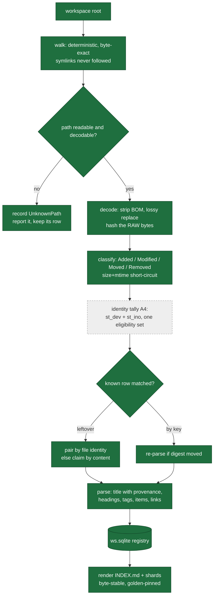
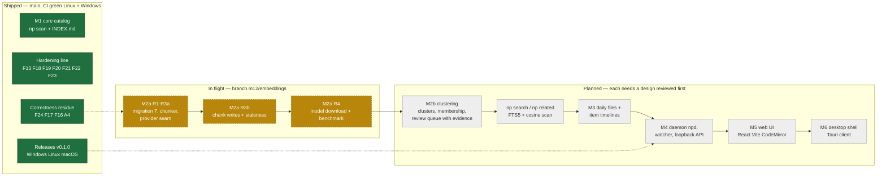
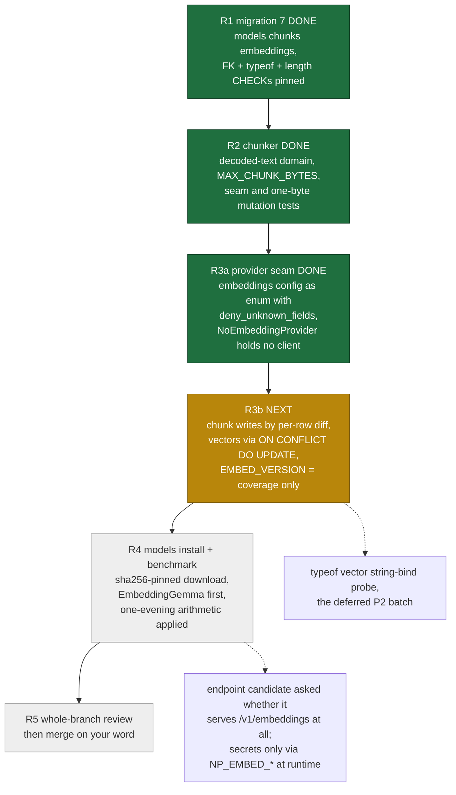

# Plan: what is built, what is next, and the steps in between

Date: 2026-10-28 · Companion to `docs/roadmap-2026-10-27.md` (milestones) and `todo.md` (handoff).
This document answers a different question: **what does the machine do today, and in what order does the rest arrive?**

Legend used by every diagram below:

| style | meaning |
|---|---|
| solid, filled | shipped on `main`, tested, released |
| dashed | exists on branch `m12/embeddings`, not merged |
| grey | planned, no code yet |

---

## 1. The scan pipeline as it runs today

**Nothing below `K` reads vectors yet.** That is a deliberate fence: it is why the golden bytes have not moved since M1 and why M2a can merge before the model question is answered.

---

## 2. Milestones: shipped, in flight, planned

---

## 3. What is left inside M2a, in order

Each box is one bounded round: fresh implementer, fresh scoped reviewer, fix loop for Critical/Important, whole-branch review at the end, merge only on your word.

**Why the order is not negotiable.** Writing vectors before `EMBED_VERSION` means splitting coverage from availability later, under time pressure — and that split (design §5) is the one place in this milestone where a wrong choice makes every scan re-chunk ~18k chunks forever.

---

## 4. Where each of your problems gets solved

| Your stated problem | Solved at | Status |
|---|---|---|
| "I cannot find things" — navigation | M1 catalog, links, tags | shipped today |
| "I cannot find things" — semantic recall | M2b + `np search` | R3b → R4 → M2b |
| "What is still open?" — item status | M1 items with markers; **timelines at M3** | partial: statuses stored, timelines not |
| Daily note with generated TODO segment | M3 + the endpoint | planned; needs your answer on `YYYY-MM-DD.md` vs `daily/` |
| Contradictions shown on both sides | M2b review queue | planned |
| Chat with `file:line` citations | after M2b search, before M5 UI | planned |
| Something I can click | M5 web UI, M6 desktop | planned; today it is a CLI plus `INDEX.md` |

---

## 5. Debts recorded rather than hidden

- **A4** merged on your word without its A/B/A benchmark or whole-branch review.
- **F18**: Windows file identity needs real hardware; CI proves only that the path is inert.
- **F25**: an over-wide token can render a physical line holding only `-`. Filed, unadjudicated.
- **Chunker deferrals**: no overlap between chunks yet, and fence-blindness — a fenced block containing a blank line can be split in half. Both in `docs/backlog-m2-followups.md`.
- **No FTS5 yet**: keyword search waits until there is summary text to index over, so the derived-data path is built once.
- Two rounds of M2a were pushed without running `cargo doc --deny warnings`; that gate caught a real break two rounds late and is back in the per-round list for good.
